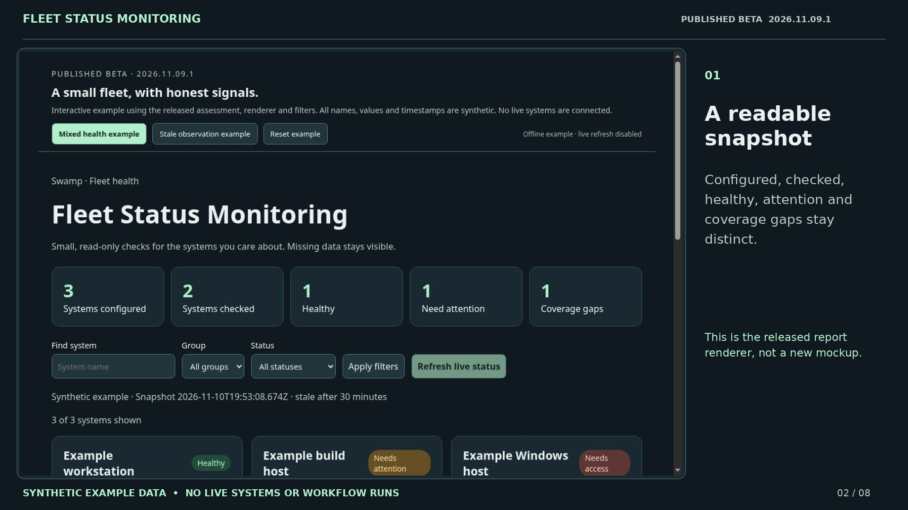

# Fleet Status Monitoring · beta/v1 example

A small, honest walkthrough of **@jpisgeek/fleet-status-monitoring 2026.11.09.1**, published on Swamp Club's **beta** channel.



## Get the demo

- [Download the complete demo ZIP](https://github.com/jpisgeek/slog-bog/raw/refs/heads/demo/fleet-beta-2026.11.09.1/demos/fleet-status-monitoring/2026.11.09.1/fleet-beta-demo.zip)
- [Watch or download the 50-second MP4](https://github.com/jpisgeek/slog-bog/raw/refs/heads/demo/fleet-beta-2026.11.09.1/demos/fleet-status-monitoring/2026.11.09.1/fleet-beta-walkthrough.mp4)
- [WebVTT captions](fleet-beta-walkthrough.vtt)

Unzip the bundle and open **index.html** in a browser for the interactive example. Open **watch.html** for the captioned video player. No server, account, or live infrastructure connection is needed. The files work offline; the source links require an internet connection.

## What matches the release

The demo executes the unchanged assessment, report renderer, schema validation and filtering controls from [this exact published source commit](https://github.com/jpisgeek/slog-bog/tree/b859ddfa03501ff2a6fcb992f91f8a793b1526cd/fleet-status-monitoring). File hashes are recorded in [demo-provenance.json](demo-provenance.json).

It demonstrates:

1. A readable summary that distinguishes configured, checked, healthy, attention and gaps.
2. Filtering by name, group or status without running a check.
3. An attention signal for low startup-data free space.
4. An access gap with unknown values, rather than invented zeroes.
5. A stale observation that no longer counts as fresh health.

## What this example is not

**Every system, measurement and timestamp in the demo is synthetic.** No real hostnames, addresses, credentials or operational run receipts are included. This is not a recording of the author's infrastructure, a deployed-release claim, a live scan, or a Swamp workflow run.

The demo host supplies examples and disables the report's live refresh button. Its Content Security Policy blocks network connections. Opening or resetting the example creates fresh synthetic timestamps; the stale scenario explicitly creates a one-hour-old sample. The released freshness logic remains active.

The MP4 is a 50-second edited walkthrough assembled from screenshots of actual interactions with this released-code example. It is caption-led, has no audio, and uses cuts between steps. It does not show a live refresh or invent a successful workflow run.

## Install the beta

```sh
swamp extension pull @jpisgeek/fleet-status-monitoring --channel beta
```

This is a beta release, not a stable release. [Quickstart](https://github.com/jpisgeek/slog-bog/blob/b859ddfa03501ff2a6fcb992f91f8a793b1526cd/fleet-status-monitoring/QUICKSTART.md) and [hosting notes](https://github.com/jpisgeek/slog-bog/blob/b859ddfa03501ff2a6fcb992f91f8a793b1526cd/fleet-status-monitoring/HOSTING.md) describe real server-backed use. Pulling the extension does not install a native dashboard page or start a server.

The HTML example and walkthrough are MIT licensed. See LICENSE and THIRD-PARTY-NOTICES.txt. The extension source and registry release were not changed to make this demo.
